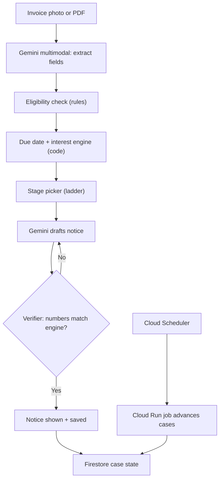

# Late-Payment Chaser — Hack Sprint (FinTech) Project Doc

<aside>
🎯

**One-liner:** Upload an overdue invoice. The agent works out the interest the law says you are owed, writes escalating notices, tracks the clock, and prepares your complaint if the buyer still does not pay.

**Track:** FinTech and Commerce (GeeksforGeeks x Google Cloud Hack Sprint, 12 hours)

**Status:** Idea finalised. Synthetic demo data only, and we say so openly.

</aside>

---

# 1. The problem in simple words

Riya runs a small design studio. She did work for a bigger company. The company has not paid her for two months. She feels awkward chasing them, and she does not know that the law says the company must pay **extra money (interest)** for paying late.

- Small suppliers are scared to chase big clients.
- They do not know their legal rights, and they cannot calculate what they are owed.
- The law already protects them. The missing piece is a tool that makes the rights easy to use.

**Why this passes the four-filter test from the workshop**

| Filter | Our answer |
| --- | --- |
| Painful | A real supplier waiting on a real unpaid invoice, every week |
| Narrow | Get a small supplier paid what they are owed (no 'and also') |
| Buildable | Core flow is extract → calculate → draft → track, doable in 8 hours |
| Measurable | ₹ principal plus ₹ statutory interest owed per invoice |

**For the problem slide:** pull one real, sourced statistic on delayed payments to small businesses from the Samadhaan portal or a Lok Sabha answer. Do not use a number we cannot source.

---

# 2. What the app does (simple version)

Think of it as a **polite but smart debt collector for small businesses**.

1. Riya uploads her invoice (the bill she sent).
2. The app reads it and checks that she is covered by the law (she must be a registered small business).
3. It works out how late the payment is and how much extra the company owes. This is plain math in code, not AI guessing.
4. It writes the right message for the right time: a friendly nudge, then a firm letter, then a letter with the exact interest owed.
5. If the company still does not pay, it prepares all the details so Riya can file a complaint with the government council that handles this.

**Where AI is used:** AI reads the invoice and writes the letters. The math is done by normal code, and the app checks that the numbers in each letter match the math before showing it. That way the AI cannot make up a wrong amount.

**What Riya gets:** she does not need to know the law, she does not need to write angry emails, and she knows exactly what she is owed and what to do next.

---

# 3. The law behind it (plain language)

<aside>
⚠️

We are not lawyers. The app computes statutory interest and drafts notices from templates. The user reviews and sends. Have a mentor or a legal-minded friend sanity-check the wording before the demo.

</aside>

- **MSMED Act, 2006:** the law that protects micro and small businesses from late payment.
- **Section 15:** the buyer must pay within 45 days of accepting the goods or service. If the contract has an agreed date, the earlier of the two applies. Sources also mention a 15-day limit where there is no written agreement.
- **Section 16:** if the buyer pays late, they owe compound interest, with monthly rests, at three times the RBI bank rate.
- **Section 43B(h) (Income Tax):** if the buyer does not pay within the time limit, they cannot claim that unpaid amount as a business expense deduction in that financial year. This gives the buyer a tax reason to pay.
- **MSEFC:** the state-level council (Micro and Small Enterprise Facilitation Council) that settles these disputes. A reference is supposed to be decided within 90 days.
- **Samadhaan portal:** the government website where the supplier files the complaint to the MSEFC online.
- **Eligibility:** the supplier must be a micro or small enterprise with a valid Udyam registration to use this route. The app checks this first.

---

# 4. Technical terms in easy language

## Law and money words

| Term | Simple meaning |
| --- | --- |
| Udyam registration | Free government registration that officially says 'this is a small business'. Like an ID card for the business. No card, no protection, so the app checks it first. |
| MSME | Micro, Small and Medium Enterprise. Size labels for businesses (micro is the tiniest). Size depends on investment and yearly sales. Check current limits on the Udyam site. |
| Invoice | The bill you send for your work. |
| Acceptance / deemed acceptance | The day the buyer accepted your work. If they stayed silent, the law treats a certain day as accepted anyway. The 45-day clock starts here. |
| Bank rate | An interest rate set by the Reserve Bank of India. The law says take it and multiply by 3. We use 6% as a sample, which gives 18%. The real rate changes, so the app keeps it as a setting with a date stamp. |
| Compound interest, monthly rests | Interest on interest. Each month the interest is added to the amount, and next month's interest is calculated on the bigger total. |
| Section 15 | The 'pay on time' rule (45 days max). |
| Section 16 | The 'pay extra if late' rule (3x bank rate, compounded monthly). |
| Section 43B(h) | Tax rule that stops the buyer deducting unpaid dues beyond the limit, so they would pay more tax. |
| MSEFC | State government panel that settles small-business payment disputes. |
| Samadhaan portal | Government website to file the delayed-payment complaint online. |

## Tech words

| Term | Simple meaning |
| --- | --- |
| Gemini (multimodal) | Google's AI that can read images, not just text. It reads the invoice photo. |
| Function calling | We give the AI a list of tools (calculate interest, write notice, check eligibility). The AI picks which tool to use and when. |
| Agent / agentic | An AI that plans steps, uses tools, checks its work and reports back, instead of answering one question. |
| Deterministic | Same input always gives the same output, like a calculator. The interest engine is deterministic. The AI is not, so we never let it do math. |
| Verifier | A small code check that compares the numbers in a letter to the calculator. If they differ, the letter is blocked and rewritten. |
| State machine | Each case is in exactly one stage (reminded, notice sent, filing ready) and moves forward by rules. Like game levels. |
| Firestore | Google's database. Stores each invoice and its current stage. |
| Cloud Run | Where our backend runs on Google's servers, giving a public link anyone can open. |
| Cloud Scheduler | An alarm clock in the cloud. Wakes our code daily to check which invoices need the next letter. |
| Synthetic data | Fake but realistic data we create ourselves. The workshop asks us to say openly when we use it. |

---

# 5. How it works (flow)

1. **Upload:** Gemini multimodal extracts invoice number, amount, accepted date, agreed credit days, buyer name.
2. **Eligibility check:** Udyam registered? Micro or small? If not, the flow stops and says what to do (register first).
3. **Due date (code):** earlier of the agreed date and acceptance + 45 days.
4. **Interest (code):** 3x bank rate, compounded monthly, on the principal from the due date to today.
5. **Pick the stage** from the escalation ladder.
6. **Draft and verify:** Gemini drafts the letter, then the verifier checks every number against the engine. Mismatch means blocked and redraft.
7. **Track:** state saved in Firestore, next action and unlock date shown on a timeline.
8. **Filing pack:** if still unpaid, prepare invoice details, buyer details, amount, interest and the history of reminders for the Samadhaan portal.

## Escalation ladder (rule table, thresholds configurable)

| Days overdue | Stage |
| --- | --- |
| 0 to 7 | Friendly reminder |
| 8 to 30 | Formal reminder (cites Sections 15, 16 and 43B(h)) |
| 31 to 60 | Notice with the exact interest owed |
| 60 plus | Filing pack for the council |

A **tone slider** (friendly, firm, formal) lets the user control how hard the letters read, because many users fear damaging the client relationship.

---

# 6. Architecture



- **Gemini function calling** with tools: `extract_invoice`, `check_eligibility`, `compute_interest`, `draft_notice`, `schedule_followup`, `build_filing_pack`.
- **Verify step:** the agent re-runs `compute_interest` and cross-checks every number in a drafted notice. A mismatch blocks sending.
- **State machine** per case: `invoice_received → reminded → formal → notice → filing_ready → paid`.
- **Scheduling:** Cloud Scheduler triggers a Cloud Run job. For the demo, a 'simulate +30 days' button fakes time passing, and we say openly that it is a simulation.
- **Sending:** drafts are exported as PDF or email text. Real sending is mocked and labelled.

**Google services and why (be ready for 'what breaks without it?')**

| Service | Why we use it | What breaks without it |
| --- | --- | --- |
| Gemini API (multimodal + function calling) | Reads messy invoices and drives the agent loop | No extraction, no letters, no agent |
| Cloud Run | Hosts the backend, scales to zero, gives a demo URL | No public link judges can open on a phone |
| Firestore | Stores each case and its state | No tracking across stages |
| Cloud Scheduler | Advances cases on a timer | Escalation would need manual clicks |
| BigQuery (optional) | Buyer payment history for the score feature | No cross-case buyer analytics |

**The hard technical piece (our pitch line):** a deterministic, auditable interest engine plus an agent that cannot state a number the engine did not produce. The LLM writes and plans. Code does the math.

---

# 7. Traced example: one invoice, start to finish

<aside>
📌

**Setup (all synthetic).** Supplier: Riya, small web-design studio, Udyam-registered as a **small** enterprise. Buyer: Acme Retail Pvt Ltd. Invoice INV-042 for ₹50,000, services accepted on 1 Aug 2026. The invoice says 'payment within 60 days'. Today is 13 Oct 2026.

**Two assumptions to confirm:** the RBI bank rate is 6% (illustrative only), so the interest rate is 3x = 18% per year. Full months compound at 1.5% each, and a partial month is simple interest on the accumulated amount.

</aside>

## Step 1: Extract (Gemini multimodal)

```
extract_invoice(image) →
{ invoice_no: "INV-042", amount: 50000, accepted: "2026-08-01",
  agreed_credit_days: 60, buyer: "Acme Retail Pvt Ltd" }
```

Firestore: state = invoice_received

## Step 2: Eligibility (rule check)

```
check_eligibility(udyam: "UDYAM-MH-xx", category: "small") → ELIGIBLE
```

If this returned 'not registered', the flow stops and tells Riya to register first.

## Step 3: Due date (code)

Agreed credit is 60 days, but the statutory limit is 45 days from acceptance, so the engine caps it.

```
due_date = min(1 Aug + 60d, 1 Aug + 45d) = 15 Sep 2026
days_overdue = 15 Sep → 13 Oct = 28 days
```

## Step 4: Interest (code, not LLM)

28 days is under one month, so no compounding yet.

```
interest = 50,000 × 18% × 28/365 = ₹690.41
owed     = ₹50,690.41
```

The UI shows: **₹50,000 + ₹690 interest, 28 days overdue.**

## Step 5: Pick the stage

28 days overdue means **formal reminder**.

## Step 6: Draft and verify

First attempt, the draft says 'interest of ₹700'.

```
verify(draft) → MISMATCH: draft ₹700 ≠ engine ₹690.41 → BLOCKED, redraft
```

Second attempt says ₹690.41, so it passes. The letter cites the 45-day rule and the tax disallowance under Section 43B(h), which gives Acme a reason to pay.

Firestore: state = reminded, next_action = 'notice unlocks at day 31'

## Step 7: Demo button '+30 days' (simulated, say so)

Date becomes 12 Nov 2026. Overdue is now 58 days.

```
month 1:   50,000 × 1.015          = 50,750.00   (₹750 interest)
partial:   50,750 × 18% × 28/365   = ₹700.77
interest = ₹1,450.77   →   owed = ₹51,450.77
```

58 days means stage **notice with exact interest**. The agent drafts it, the verifier checks ₹1,450.77, and the notice states principal, interest and the legal basis.

Firestore: state = notice

## Step 8: Another +30 days (12 Dec 2026, 88 days overdue)

```
month 1: 50,000 × 1.015 = 50,750.00
month 2: 50,750 × 1.015 = 51,511.25
partial (27 days): 51,511.25 × 18% × 27/365 = ₹685.88
interest = ₹2,197.13   →   owed = ₹52,197.13
```

Stage is 60 plus, so the **filing pack** is built: invoice details, buyer details, amount, interest, and the timeline of reminders sent, ready for the Samadhaan portal.

Firestore: state = filing_ready

## Honest observation

Interest is small early (₹690 on ₹50,000). The pitch is not 'the interest is huge'. It is the principal recovered, the tax-disallowance leverage, and the tracked escalation. A bigger invoice makes the number land harder. Interest scales linearly, for example ₹2,00,000 gives ₹2,761.64 at day 28.

---

# 8. Extra features

One rule from the workshop: five things at 40 percent lose, one at 100 percent wins. So we build the core first, then at most these three, in this cut order if time runs short.

## Build (only after the golden path works)

### A. Reply-reading agent (while chasing) — never cut this one

The user pastes the buyer's reply (email or WhatsApp text). Gemini classifies it and the state machine adapts.

- **Promise:** 'Sorry for the delay, will pay by 20 Nov.' → intent = promise_to_pay, date = 2026-11-20. The ladder pauses until that date. If it passes unpaid, the next letter opens with 'You committed to paying by 20 Nov' and the stage jumps up.
- **Dispute:** 'The design quality was poor, we are not paying in full.' → intent = dispute. The ladder stops, the case is flagged, the app drafts a reply asking for specifics in writing, and warns the user that a dispute can complicate the claim.

Effort: about 1.5 hours.

### B. Contract guard (before the work starts)

Upload a purchase order or contract before accepting the job. Gemini finds the payment clause and a rule compares it to the 45-day cap. Example: 'Payment within 90 days of invoice' is flagged, a replacement clause is suggested, and a short negotiation email is drafted. Effort: about 2 hours.

### C. Buyer payment score (across cases)

Every case feeds a BigQuery table. Each buyer gets average days late, percent paid late and worst delay. Demo line: 'Acme Retail pays on average 41 days late. Think before accepting this job.' Seeded with fictional buyers. Keep scores private per user in the demo, since publicly naming real companies across users creates legal risk. Effort: about 1 hour.

## Roadmap slide only (do not build)

- Hindi and Marathi notices and voice entry (Translation API, Speech-to-Text)
- Google Sheets import to chase a whole ledger
- Looker Studio dashboard for receivables aging
- Evidence pack for the council filing
- Real sending via Gmail API or WhatsApp Business

## Reply classifier schema (starting point)

```
{
  "intent": "promise_to_pay | dispute | partial_payment | acknowledgement | no_info",
  "promised_date": "YYYY-MM-DD or null",
  "promised_amount": "number or null",
  "dispute_reason": "string or null",
  "suggested_next_stage": "pause | hold | continue | escalate"
}
```

Tool list with extras: extract_invoice, check_eligibility, compute_interest, draft_notice, schedule_followup, build_filing_pack, classify_reply, review_contract, score_buyer.

---

# 9. Demo data (synthetic, say so openly)

- **Invoice 1:** clearly eligible and 60 days overdue. Main demo.
- **Invoice 2:** still within terms. The app correctly does nothing.
- **Invoice 3:** supplier not Udyam-registered. The app says so honestly (our credibility moment in Q and A).
- Headline moment: ₹50,000 invoice → amount owed ticks up → notice generated → press '+30 days' → next stage unlocks.

---

# 10. 12-hour plan and lanes

| Window | What happens |
| --- | --- |
| H0 to H1 | Lock the idea, write the one-sentence problem on paper, assign roles, pick the 3 demo invoices. Idea lock within 45 minutes. |
| H1 to H2 | Integration builder deploys hello-world on Cloud Run with a live URL. Core builder starts the interest engine (pure code, fast). Interface owner sketches 3 screens. |
| H2 to H7 | Golden path: extract → eligibility → interest → drafts → state machine. Story owner researches wording and the statistic, and writes the Q and A. |
| H5 to H7 | Add the reply-reading agent once the state machine works. |
| H7 to H9 | Freeze. No new features, except contract guard or buyer score if the golden path is solid. Fix edge cases (zero days overdue, no agreed credit period), seed data. |
| H9 to H10.5 | Deck and demo script. Rehearse twice. Record a 90-second backup video. |
| H10.5 to H12 | Submit with 60 minutes spare: repo, README, links, form. |

**Four lanes**

1. **Builder, core:** interest engine, state machine, verifier. The most protected person on the team.
2. **Builder, integration:** Gemini calls, Cloud Run, Firestore, scheduler, data seeding. Gets the URL live by hour 2.
3. **Interface owner:** one screen that makes the one flow look finished: invoice card with amount owed, timeline, next-notice button.
4. **Story owner:** statistic, impact numbers, deck, script, five Q and A answers, submission form. Starts at hour 1.

**Non-negotiables:** one shared repo from minute one, a 15-minute stand-up every 3 hours, branch early, one person has the final say on scope.

---

# 11. Pitch (3 minutes)

| Time | Beat | What we say or do |
| --- | --- | --- |
| 0:00 | Hook | Riya did the work. Two months later she is still unpaid, and she does not know the law says she is owed interest. (Add the sourced statistic.) |
| 0:30 | Turn | We built a tool that chases for her. Watch what happens when she uploads an invoice. |
| 0:45 | Demo | Upload → amount owed ticks up → notice appears → '+30 days' → next notice → filing pack. Narrate what the user sees, not what the code does. |
| 2:15 | Proof | Runs on Cloud Run, the math is deterministic and verified, Gemini does extraction and drafting. |
| 2:45 | Close | Next we add voice and Hindi or Marathi support, and we can pilot it with local small businesses. |

One person pitches. The rest stay silent unless asked. Open on the user's screen, never the code editor. Never live-code. Put a QR code to the live URL on the last slide.

**8-slide deck**

1. Title: team, track, one-line pitch
2. The problem: one user, one pain, one statistic
3. Why now: why it is unsolved or badly solved today
4. Solution: one screenshot, three sentences
5. How it works: architecture with Google services named
6. Demo: link, QR code, or the video
7. Impact: ₹ owed and recovered per invoice, users reached
8. What is next: roadmap, feasibility, ask

Rules: no paragraphs, no screenshots of code, no fonts smaller than 16pt.

---

# 12. Judge Q and A (assign one person to write final answers by hour 9)

- What is actually working right now?
    
    Live: extraction, eligibility check, interest calculation, drafts, verification, state machine. Mocked: email delivery and the time-skip button. Cases are synthetic.
    
- Is this legal advice?
    
    No. It computes statutory interest and drafts notices from templates. The user reviews and sends.
    
- What if the user is not Udyam-registered?
    
    The app checks first and says so, then points to registration.
    
- How is this different from existing tools?
    
    Name two real competitors and one sharp difference. The Samadhaan portal handles filing but does not calculate interest, draft letters or track escalation. Generic invoicing apps send reminders with no statutory interest.
    
- Which bank rate do you use?
    
    A configurable value taken from the current RBI rate, with the date stamped on every notice.
    
- Why Gemini, and what breaks without it?
    
    It reads messy invoice images of any format and drives the tool-calling agent. Without it we have no extraction and no letters.
    
- How would you scale this to 10,000 users?
    
    The known bottleneck is document extraction cost and latency. Cache templates per buyer format, batch the scheduler job, and keep the interest engine stateless on Cloud Run.
    
- How much did you build today?
    
    Be ready to show commit history. Never present pre-existing code as new.
    
- Will anyone really send a legal notice to a client?
    
    The tone ladder starts friendly and escalates only if needed. Many users just need the number and the right wording.
    

---

# 13. Risks and how we handle them

- **Interest rules:** compounding edge cases and which date counts as 'acceptance' are where we could get caught. Get a legal-minded sanity check.
- **Relationship fear:** handled with the tone slider and a gentle-first default.
- **Less ML than other ideas:** make the agent loop and the verify step very visible on screen (a small log panel showing 'blocked, redrafted, passed').
- **Interest is small early:** use a larger invoice in the demo and lead with principal recovered plus the tax leverage.
- **Scope creep:** extras only after the golden path is solid. Do not build login, an admin panel, dark mode or a chatbot.

---

# 14. Submission checklist

- [ ]  Public repo with a README that explains setup in 5 lines
- [ ]  Deployed URL that opens on a phone, tested on mobile data, not campus Wi-Fi
- [ ]  Backup demo video (90 seconds) uploaded and link tested
- [ ]  Deck exported to PDF as well as the required format
- [ ]  Google technologies clearly named in the deck and the README
- [ ]  Team details and track selected correctly on the portal
- [ ]  Everything submitted at least 60 minutes before the deadline

---

# 15. Open items before we start building

- [ ]  Look up the current RBI bank rate and decide the config value
- [ ]  Confirm the compounding convention with someone legally minded
- [ ]  Find one sourced statistic on delayed payments to small businesses
- [ ]  Write the 3 synthetic invoices
- [ ]  Name two real competitors for the Q and A
- [ ]  Assign the four lanes

---

# 16. Sources used

- [MSME Samadhaan overview (Vikaspedia)](https://www.vikaspedia.in/e-governance/online-citizen-services/government-to-business-services-g2b/msme-samadhaan)
- [Delayed payment legal framework (DC MSME)](https://www.dcmsme.gov.in/publications/LegalFramework.pdf)
- [MSME Samadhaan portal guide and Section 43B(h) (IIFL)](https://www.iifl.com/blogs/other/msme-samadhaan-portal-how-to-file-delayed-payment-complaint)
- [Lok Sabha answer on MSME Samadhaan](https://eparlib.nic.in/bitstream/123456789/2501340/1/AU2328.pdf)
- Official portal: [samadhaan.msme.gov.in](http://samadhaan.msme.gov.in)