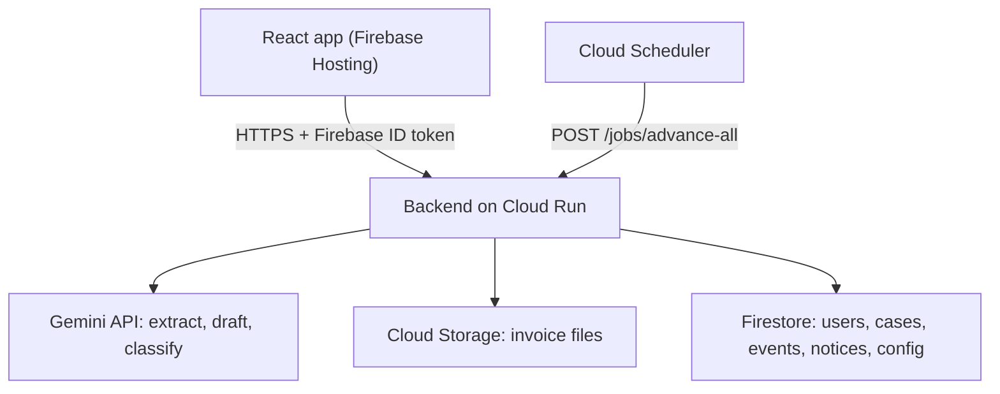
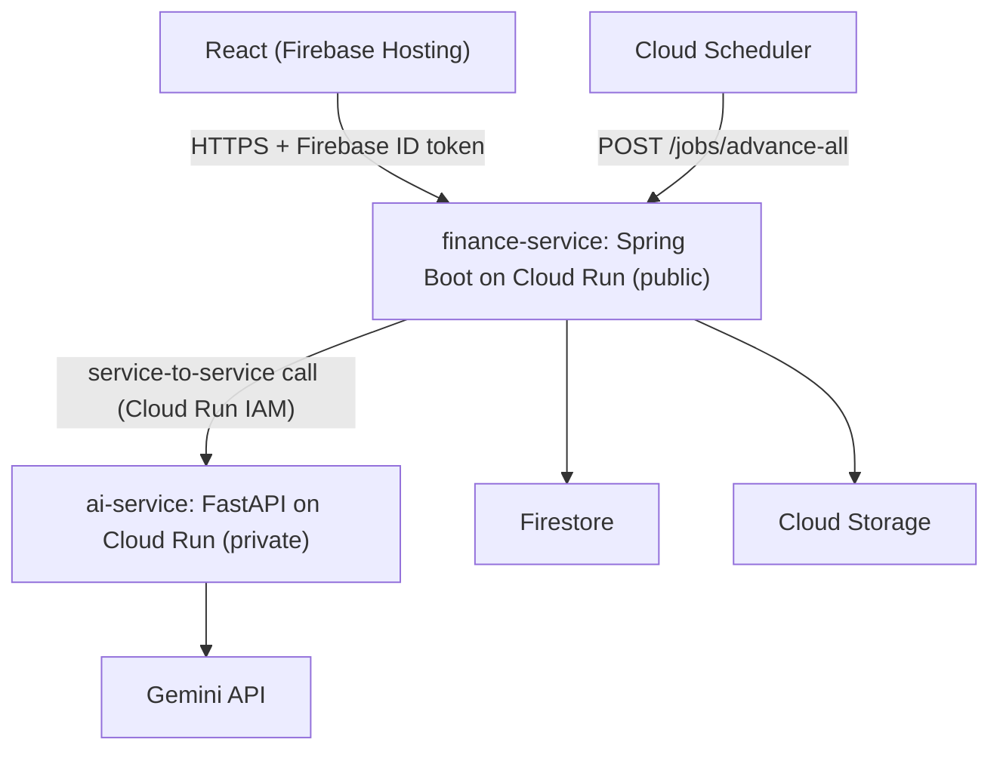

# Late-Payment Chaser — Technical Spec and Architecture

<aside>
🛠️

**Purpose:** the full technical blueprint for the Late-Payment Chaser (GeeksforGeeks x Google Cloud Hack Sprint, FinTech track). Covers requirements, stack, data model, APIs, the core engine, the agent design, the end-to-end flow, and the proposed Java (Spring Boot) plus Python split.

**Priority key:** P0 = must ship (golden path). P1 = ship if the golden path is solid by H7. P2 = only if time is left, otherwise roadmap slide.

</aside>

---

# Part A. Technical spec

## 1. Scope

**Actors:** the supplier (the only logged-in user), the buyer (external, no login, appears only in letters), and judges (open the live URL).

**In scope (P0):** upload invoice → extract → confirm → eligibility → due date → interest → stage → draft and verify notice → timeline → simulate time → filing pack.

**Out of scope:** real email or WhatsApp sending, partial-payment handling (a case is either unpaid or marked paid), multi-user teams, payments, a real RBI or Udyam API lookup, Hindi and Marathi UI, legal advice.

---

## 2. Functional requirements

| ID | Requirement | Pri |
| --- | --- | --- |
| FR-01 | Demo login (hardcoded or Firebase anonymous auth). Auth is not the point. | P0 |
| FR-02 | Supplier profile: business name, Udyam number (format-checked only), category (micro, small, medium, none) | P0 |
| FR-03 | Upload invoice (JPG, PNG, PDF, max about 10 MB) with a preview | P0 |
| FR-04 | Gemini extracts: invoice number, amount, buyer name, invoice date, accepted date, agreed credit days | P0 |
| FR-05 | Confirm screen: the user can edit every extracted field before anything is calculated. Extraction is never trusted blindly. | P0 |
| FR-06 | Eligibility check (Udyam present, category is micro or small). If it fails, stop and show why and what to do. | P0 |
| FR-07 | Due-date engine: min(agreed date, accepted date + 45 days) | P0 |
| FR-08 | Interest engine (deterministic code): 3x bank rate, monthly compounding, partial month as simple interest | P0 |
| FR-09 | Stage picker from the escalation ladder (rule table in config) | P0 |
| FR-10 | Notice drafting with a tone option (friendly, firm, formal) | P0 |
| FR-11 | Verifier: every number in a draft must match the engine, with retry and fallback | P0 |
| FR-12 | Case state machine and timeline: invoice_received → reminded → formal → notice → filing_ready → paid | P0 |
| FR-13 | Simulate +N days button (labelled as a simulation) | P0 |
| FR-14 | Export notices as PDF and copyable text | P0 |
| FR-15 | Filing pack: structured summary and PDF for the Samadhaan complaint | P0 |
| FR-16 | Case list with total principal and total interest owed | P0 |
| FR-17 | Agent trace panel (tool calls, verify results, blocked then passed) | P0 |
| FR-18 | Mark case as paid | P0 |
| FR-19 | Reply-reading: paste a buyer reply and Gemini classifies it (promise, dispute, partial, acknowledgement). The state machine adapts. | P1 |
| FR-20 | Cloud Scheduler daily job that advances all cases | P1 |
| FR-21 | Config screen or file: bank rate (with date stamp), ladder thresholds | P1 |
| FR-22 | Contract guard: extract the payment clause, compare to the 45-day cap, suggest replacement wording | P2 |
| FR-23 | Buyer payment score from BigQuery (private per user) | P2 |

---

## 3. Non-functional requirements

| Area | Requirement |
| --- | --- |
| Correctness | Interest and dates must be reproducible. The golden test cases (₹690.41, ₹1,450.77, ₹2,197.13, ₹2,761.64) must pass in CI. The LLM never produces a figure that reaches the user without verification. |
| Performance | Extraction under 10 s. Interest and stage calculation under 200 ms. Notice draft under 8 s. Page load under 3 s on mobile data. |
| Reliability | Gemini calls get a timeout (about 20 s) and 2 retries. If extraction fails, fall back to manual entry. Cached responses for the 3 demo invoices so the demo survives an API failure. |
| Explainability | Show the formula, inputs and result for every amount. A judge should be able to follow the math on screen. |
| Security | No API keys in the client. Secrets in Secret Manager. Firestore rules scope data to the owning user. File type and size validation. Scheduler endpoint requires an authenticated service identity. CORS limited to the app origin. |
| Prompt-injection safety | Invoice text and buyer replies are untrusted data. Strict JSON schemas, no tool execution driven by document content, and fields validated by code. |
| Privacy | Synthetic data only. A delete-case option. No real Udyam numbers or buyer details in the repo. |
| Usability | Mobile-first and responsive. Plain-English copy. One main flow per screen. Judges can open it on a phone. |
| Observability | Structured logs per request with case ID. The agent trace is stored in Firestore for the demo panel. |
| Cost | Free tier and credits. Cloud Run scales to zero. Use a fast, cheap Gemini model (check AI Studio for the current model name). |
| Maintainability | Single repo, .env.example, 5-line README, interest engine in one pure module with unit tests. |
| Legal and ethical | Visible disclaimer on every notice: statutory-interest estimate, user reviews before sending. |

---

## 4. Tech stack

| Layer | Choice | Why |
| --- | --- | --- |
| Frontend | React + Vite + Tailwind (mobile-first) | Fast to build, easy to deploy |
| Hosting (UI) | Firebase Hosting | Live URL in minutes |
| Backend (single-language option) | Python FastAPI on Cloud Run | Best Gemini SDK support and PDF libraries |
| Backend (two-service option) | Spring Boot finance-service plus Python ai-service (see Part B) | Exact decimal and date logic in Java, fast AI integration in Python |
| AI | Gemini API (multimodal, function calling, structured JSON output) via the Google GenAI SDK | Reads invoice images, drives drafting and classification |
| Database | Firestore | Cases, events, notices, config |
| File storage | Cloud Storage (or Firebase Storage) | Uploaded invoices |
| Auth | Firebase Auth anonymous or hardcoded | Minimal |
| Scheduler | Cloud Scheduler → authenticated Cloud Run endpoint | Daily escalation |
| Secrets | Secret Manager | Gemini key |
| PDF output | ReportLab or WeasyPrint (Python), OpenPDF (Java) | Notices and filing pack |
| Analytics (P2) | BigQuery | Buyer score |
| Testing | pytest and JUnit 5 (engine), a small image test set (extraction) | Correctness |
| CI/CD | gcloud run deploy --source . or Cloud Build | Deploy early, deploy often |
| Repo | Public GitHub, branch early | Required by the submission checklist |

---

## 5. System architecture (single-service view)



Inside the backend keep these as separate modules: extraction, eligibility, engine (dates and interest, pure code), ladder, drafting, verifier, state, pdf, agent (orchestrator).

---

## 6. Data model (Firestore)

```
users/{uid}
  business_name, udyam_number, category, created_at

cases/{caseId}
  owner_uid, buyer_name, invoice_no, principal, invoice_date,
  accepted_date, agreed_credit_days, file_path,
  due_date, state, stage, tone, status (open | paid),
  simulated_offset_days, promise_date (nullable),
  last_calc { days_overdue, interest, total, rate_used, bank_rate_date },
  created_at, updated_at

cases/{caseId}/notices/{noticeId}
  stage, tone, subject, body, numbers {principal, interest, total,
  days_overdue, due_date}, verified (bool), attempts, created_at

cases/{caseId}/events/{eventId}      // agent trace + audit log
  type (extract | eligibility | calc | draft | verify | state_change | reply),
  payload, ts

config/settings
  bank_rate, bank_rate_date, ladder [{min_days, max_days, stage}]

buyers/{buyerKey}   // P2
  user-scoped stats: avg_days_late, pct_late, worst_delay
```

---

## 7. API endpoints (public API)

| Method | Path | Purpose |
| --- | --- | --- |
| POST | /cases | Upload the invoice and create a case |
| POST | /cases/{id}/extract | Run Gemini extraction |
| PATCH | /cases/{id}/confirm | User-edited fields, then eligibility, due date and interest run |
| GET | /cases | List cases with totals |
| GET | /cases/{id} | Case, last calculation, timeline, trace |
| POST | /cases/{id}/draft | Draft and verify the notice for the current stage and tone |
| POST | /cases/{id}/simulate | days: 30 advances the simulated clock and re-runs the stage |
| POST | /cases/{id}/reply | Classify a pasted buyer reply (P1) |
| POST | /cases/{id}/filing-pack | Build the filing summary and PDF |
| POST | /cases/{id}/paid | Mark paid |
| POST | /contracts/review | P2 |
| GET | /buyers/{name}/score | P2 |
| POST | /jobs/advance-all | Internal, called by Cloud Scheduler |

---

## 8. Core engine spec

**Due date:** due = min(agreed_date, accepted_date + 45 days). If no credit period was agreed, the statutory default applies. Sources mention 15 days in that case, so make it a config value and have a legal check confirm it.

**Interest (use exact decimals, round to paise at the end only).** Python reference version:

```python
from dateutil.relativedelta import relativedelta
from decimal import Decimal

def interest(principal, due, today, bank_rate):
    if today <= due:
        return Decimal("0.00")
    r = 3 * bank_rate                      # e.g. 0.06 -> 0.18
    months = 0
    while due + relativedelta(months=months + 1) <= today:
        months += 1
    amt = principal * (1 + r / 12) ** months
    rem_days = (today - (due + relativedelta(months=months))).days
    amt += amt * r * rem_days / 365
    return (amt - principal).quantize(Decimal("0.01"))
```

**Conventions (write these in the README and get them confirmed):**

- Interest starts accruing from the due date.
- A full month is a calendar month from the due date.
- The partial month uses simple interest on 365 days.
- The bank rate comes from config with its date stamp. The 6% used in examples is illustrative only.

**Golden tests** (principal ₹50,000, due 15 Sep 2026, rate 6%):

- Today 13 Oct 2026 → ₹690.41
- Today 12 Nov 2026 → ₹1,450.77
- Today 12 Dec 2026 → ₹2,197.13
- Principal ₹2,00,000 on 13 Oct 2026 → ₹2,761.64

**Edge cases:** today equals due date (0), today before due (0), due date on the 31st, leap day, zero principal, missing accepted date (blocked at the confirm screen).

---

## 9. Agent design

**Tools** (each has a typed input and output): extract_invoice, check_eligibility, compute_due_and_interest, pick_stage, draft_notice, verify_notice, build_filing_pack, plus classify_reply (P1).

**Loop for FR-10 and FR-11:**

1. The orchestrator calls compute_due_and_interest and pick_stage.
2. It calls draft_notice with those numbers as input. Gemini returns structured JSON: subject, body, and cited_numbers (principal, interest, total, days_overdue, due_date).
3. verify_notice checks that cited_numbers equals the engine output and scans the body for any currency amount or date not in the allowed set.
4. On a mismatch it retries, up to 2 times, and logs each attempt to the trace panel.
5. If it is still wrong, it falls back to a fixed template with numbers injected by code. Nothing unverified is ever shown.

**Guardrails:** temperature low. Extracted fields validated by type and range. The model has no tool that sends anything. Document and reply content is never allowed to change instructions.

---

## 10. End-to-end technical flow

1. User opens the app, Firebase auth runs, profile loads.
2. Upload invoice. The file goes to Cloud Storage and POST /cases creates the case in invoice_received.
3. POST /extract. Gemini multimodal returns JSON, stored on the case, trace event logged.
4. Confirm screen. The user edits and confirms. PATCH /confirm.
5. The backend runs eligibility. If it fails, the flow stops with a clear message.
6. The backend computes due_date, days_overdue, interest, total and writes last_calc.
7. pick_stage reads the ladder from config and sets the stage.
8. POST /draft. Draft, verify, retry or fallback, notice stored, UI shows it with the formula panel.
9. The user exports the PDF or copies the text.
10. Demo: POST /simulate with days 30. The clock moves, steps 6 to 8 repeat at the new stage, state changes.
11. When the stage reaches 60 plus, POST /filing-pack builds the summary and PDF.
12. P1: the user pastes a buyer reply. POST /reply classifies it. The state machine pauses or escalates, and the next draft references the promise.
13. P1: Cloud Scheduler hits /jobs/advance-all daily and advances every open case the same way.
14. The user marks the case paid. State becomes paid and the ladder stops.

---

## 11. Screens

1. **Login** (demo) and **profile** (Udyam, category).
2. **Cases list:** total principal owed, total interest owed, status chips.
3. **Upload and confirm:** image preview next to editable fields.
4. **Case detail:** amount owed (principal plus interest), the formula, the timeline with the next unlock date, the notice with a tone selector, the Simulate +30 days button, the Paste buyer reply box (P1), and the filing pack button.
5. **Agent trace** (collapsible panel on the case detail).

Keep it to these. No settings page, no admin panel.

---

## 12. Security and test plan

**Security checklist:**

- [ ]  Firestore rules: owner_uid equals the authenticated user
- [ ]  Signed URLs for file reads
- [ ]  MIME and size checks on upload
- [ ]  Rate limit the AI endpoints
- [ ]  Scheduler endpoint rejects unauthenticated calls
- [ ]  No keys in the repo or the client bundle

**Tests:**

- **Unit:** engine golden cases and edge cases, ladder boundaries (7/8, 30/31, 60/61), the eligibility matrix.
- **Extraction:** 5 invoice images (clean photo, blurry photo, PDF, different layout, one with a missing field) and a pass or fail table.
- **Verifier:** feed a deliberately wrong draft and confirm it is blocked.
- **End to end:** the full golden path on the live URL, on a phone, on mobile data.
- **Demo rehearsal:** twice, on the actual device, with the backup video recorded.

---

## 13. Build order by lane (single-service plan)

| Lane | Hours | Deliverables |
| --- | --- | --- |
| Core builder | H1 to H4 | engine module and tests, ladder, state machine |
| Core builder | H4 to H7 | verifier, agent loop, retries and fallback |
| Integration builder | H1 to H2 | Cloud Run hello-world with a live URL, Firestore, Secret Manager |
| Integration builder | H2 to H5 | Gemini extraction, storage, endpoints, seeding the 3 demo cases |
| Integration builder | H5 to H7 | reply classifier, scheduler, PDF export |
| Interface owner | H1 to H7 | upload and confirm, case detail, trace panel, mobile layout |
| Story owner | H1 to H9 | statistic, competitors, deck, script, Q and A, README, submission form |

**Freeze at H7.** Anything unfinished moves to the roadmap slide.

---

# Part B. Two-service option: Java (Spring Boot) plus Python

<aside>
⚖️

**Verdict:** a good design on paper that fits the pitch, but it adds real overhead in a 12-hour build. Go with it only if at least two teammates are strong in Java and at least one is comfortable with Python and the Gemini SDK. If the Java people would be learning Cloud Run and Firestore for the first time, stay with single-language Python.

</aside>

## 14. Why it is good

- **Money in BigDecimal:** Java's types and java.time suit the interest and date math, and the golden tests are easy to write in JUnit.
- **Cleaner pitch line:** 'The AI service cannot touch money. It has to ask the finance service.' That answers the hallucination question structurally, not just with a verifier.
- **Parallel work:** two backend people can build at the same time once the contract is agreed.
- **Graceful failure:** if Gemini is down, the finance side still works, with template drafts and manual entry.

## 15. What it costs

- Two services means two deploys, two sets of logs, and two places a bug can hide. Budget about 1 to 1.5 extra hours.
- An API contract has to be agreed in hour 1, or both developers get blocked.
- The JVM cold-starts slowly on Cloud Run when it scales to zero. Set min-instances to 1 for demo day, or warm it up before presenting.

## 16. Recommended split

| Service | Language | Owns |
| --- | --- | --- |
| finance-service | Spring Boot (Java 17 plus) | due date, interest, eligibility, ladder, state machine, verifier, case storage (Firestore), notice and filing-pack PDFs, scheduler endpoint, the public API |
| ai-service | Python (FastAPI) | Gemini extraction, notice drafting, reply classification, contract review (P2) |
| web | React | UI, talks to finance-service only |

The AI service is **stateless**. It has no database access and no money logic.

## 17. Who orchestrates the agent

- **Option B (recommended): Spring orchestrates.** Spring computes the numbers, calls Python to draft, verifies the result itself, and retries if it fails. There is no circular call, and the verifier sits on the trusted side. The agent loop (plan, act, verify, report) is Java code calling Gemini-powered endpoints.
- **Option C: Python runs the agent loop.** Gemini function calling lives in Python, and its tools are HTTP calls back into Spring. It is more agentic on paper, but the path becomes Spring to Python to Spring, so there are more timeouts and more things to debug.

Take Option B for the 12 hours. If a judge asks about function calling, use it inside Python for the reply classifier's next-step choice, and keep Option C as a roadmap item.

## 18. Architecture (two-service view)



## 19. The contract (agree on this in hour 1)

**Spring to Python**

| Endpoint | Input | Output |
| --- | --- | --- |
| POST /ai/extract | file (or storage URI) | invoiceNo, amount, buyer, invoiceDate, acceptedDate, agreedCreditDays, fieldNotes |
| POST /ai/draft | stage, tone, supplier, buyer, numbers (principal, interest, total, daysOverdue, dueDate) | subject, body, citedNumbers |
| POST /ai/classify-reply | text, caseContext | intent, promisedDate, promisedAmount, disputeReason, suggestedNextStage |

**The one loop that matters:**

1. Spring computes the numbers.
2. Spring calls /ai/draft.
3. Spring compares citedNumbers and every amount in the body to its own calculation.
4. On a mismatch it retries up to 2 times, then falls back to a template with the numbers injected by Java.

## 20. Practical setup

**Repo layout (monorepo):**

```
/web
/finance-service   (Spring Boot)
/ai-service        (FastAPI)
/contracts         (JSON schemas or OpenAPI, the source of truth)
```

- **Java side:** Spring Web, Validation, Google Cloud Firestore SDK, OpenPDF, JUnit 5. Use LocalDate.plusMonths and ChronoUnit.DAYS.between for the date math, and BigDecimal with an explicit scale for the money.
- **Python side:** FastAPI, Pydantic (typed request and response models), the Google GenAI SDK, structured JSON output.
- **Between services:** use Cloud Run IAM with an ID token for service-to-service calls and keep the AI service private. If that takes too long to set up, use a shared secret header for the hackathon and note it as a known shortcut.
- **Mock early:** the Java developer builds against a stubbed AI service that returns fixed JSON, and the Python developer tests against a stubbed finance payload. Real integration happens around H4.

## 21. Timeline impact

- **H1 to H2:** agree on the contract, deploy both hello-world services, and confirm they can call each other. This is the new risk, so do it first.
- **H2 to H7:** the two backend lanes run in parallel. The finance-service developer owns the engine, state machine and verifier. The ai-service developer owns extraction, drafting and the classifier.
- **H7:** freeze as planned.

## 22. Judge Q and A for this design

- Why two services?
    
    The AI service cannot compute or store money. The finance service is deterministic and fully testable. Each scales on its own.
    
- What if Gemini fails?
    
    The finance path still works, with manual entry and template notices.
    
- Why not one stack?
    
    Different strengths: exact decimal and date logic in Java, fast AI integration in Python.
    

---

# 23. Open decisions to settle in the first hour

- [ ]  Backend choice: single-language Python, or the Spring Boot plus Python split
- [ ]  Which Gemini model (check AI Studio) and its free-tier limits
- [ ]  The bank rate value and its source, plus the default credit period when none is agreed
- [ ]  Who confirms the compounding and due-date conventions
- [ ]  Whether P1 items (reply classifier, scheduler) are in the build
- [ ]  Agree and commit the /contracts schemas for the /ai/* endpoints